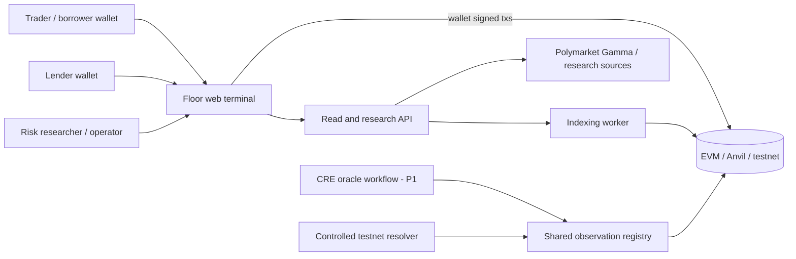
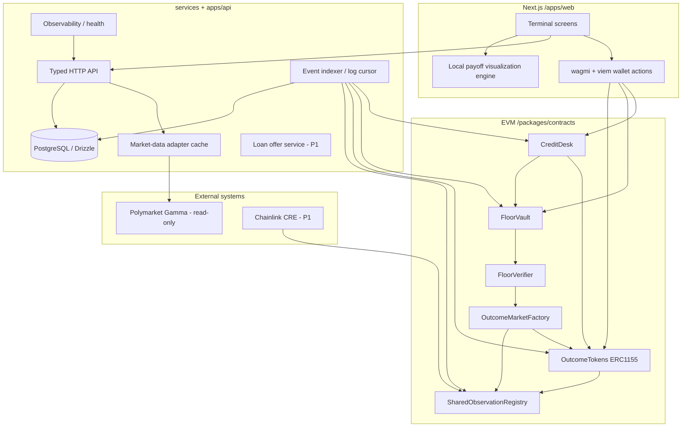

# Technical Architecture — ARQO

**State:** proposed; no code deployed. **Baseline:** single EVM chain, local Anvil then one public testnet; custody is smart-contract-controlled, not server-key-controlled.

## 1. Architecture principles

1. **Chain is source of truth** for positions, collateral inventory, loans, resolutions and cash distributions; PostgreSQL is a derived read model.
2. **Proof logic is not a backend permission**: `FloorVault.lock()` MUST call an onchain verifier using canonical immutable onchain market metadata. A browser certificate is informational only.
3. **Separate probabilistic analysis from certifiable claims**: market-data adapters, scoring engines and NLP may identify candidates but never increase the borrowing floor.
4. **No cross-chain mirage**: testnet tokens live on the chain where loans settle. External Polymarket or Solana data is read-only research unless an independently audited adapter really receives and locks those assets.
5. **Prefer explicit invariants to cleverness**: two compatible threshold legs, one observation registry, one matched lender, one debt waterfall; generalized structured finance follows.
6. **Any viewer can reproduce claims**: canonical IDs, proof rule version, position inventory, transaction logs and settlement receipts are inspectable.
7. **No UI-simulated loan state**: use realistic mock oracle only as an explicitly labeled demo input; transactions and token flows remain onchain.

## 2. System context (C4 Level 1)



### Context limits

- `Venue` helps discovery only; its event URLs, order books, and prices cannot prove a floor on another chain.
- CRE workflow can be simulated for a sponsor demonstration, but onchain provenance must identify whether a write was from a deployed workflow or a test resolver.
- The lender is **a separate wallet and counterparty**; borrower wallet cannot fabricate lender funding in a browser state reducer.

## 3. Component architecture (C4 Level 2)



### Service ownership

| Component | Owned data | Critical interface | Contract trust |
|---|---|---|---|
| Observation registry | Asset ID, time, state, price/cancel | `getObservation`, `finalize`, `cancel` | Resolver authority, immutable finalization |
| Outcome market factory | Market ID, strike, predicate, observation ID | `createMarket`, `getMarket` | Curator controls allowlist; parameters immutable |
| Outcome token contract | ERC-1155 claim balances and backing | `mintCompleteSet`, `mergeSet`, `redeem` | Escrow solvent; any arbitrary mint prohibited |
| Floor verifier | Eligibility and integer floor calculation | `verifyPair` / `floorOf` | Pure/chain-read; same observation and policy |
| Floor vault | Locked token inventory / vault position | `lockPair`, `releaseUnfunded`, `redeemToCash` | ERC-1155 receiver validates expected deposits |
| Credit desk | Lender, borrower, principal, due, state | `fund`, `settle`, `repay` | Money moves onchain, no offchain bookkeeping authority |
| API | Pagination, previews, data provenance | `GET /api/v1/...` | Read-only relative to funds |
| Indexer | Idempotent derived event log | `sync`, `reorg`, `backfill` | Never canonical for balances |
| Research adapter | External markets/prices | `GET /api/v1/research/*` | Indicative only; not loan eligibility |

## 4. Canonical transaction sequence

```mermaid
sequenceDiagram
  actor B as Borrower
  participant UI as Web + Wallet
  participant T as OutcomeTokens
  participant V as FloorVault
  participant P as FloorVerifier
  participant D as CreditDesk
  actor L as Lender
  participant O as SharedObservationRegistry
  B->>UI: Create complete sets with test USDC
  UI->>T: mintCompleteSet(marketA, 1), mintCompleteSet(marketB, 1)
  T-->>B: YES/NO tokens for both markets
  B->>UI: Compose YES A + NO B
  UI->>P: preview floor from chain metadata
  P-->>UI: 1.000000 USDC contractual floor
  B->>UI: Approve and lock
  UI->>V: lockPair(marketA YES, marketB NO, 1, 1)
  V->>P: verifyPair using onchain immutable metadata
  P-->>V: verifiedFloor = 1 USDC
  V->>T: safeBatchTransferFrom borrower
  V-->>B: VaultPositionCreated(positionId)
  L->>UI: Fund 0.75 USDC / 0.78 due
  UI->>D: fundLoan(positionId, 0.75, 0.78)
  D->>V: assert locked and unfunded; mark encumbered
  D->>L: transferFrom test USDC
  D-->>B: transfer principal USDC
  O->>O: After observation time, finalize(5500)
  B->>UI: Settle when finalized
  UI->>D: settle(loanId)
  D->>V: redeem both claims
  V->>T: redeem winning ERC1155 tokens
  T-->>V: 2.00 test USDC
  V-->>D: 2.00 test USDC
  D-->>L: 0.78 test USDC
  D-->>B: 1.22 test USDC
  D-->>UI: LoanSettled event and receipts
```

## 5. Borrowing business flow and state machines

```mermaid
stateDiagram-v2
  [*] --> OPEN: lock collateral
  OPEN --> RELEASED: owner unlocks; no loan
  OPEN --> FUNDED: lender funds and debt is bounded
  FUNDED --> SETTLEMENT_READY: observation FINALIZED or CANCELLED
  FUNDED --> RESOLVER_DELAYED: observation unresolved after due time
  RESOLVER_DELAYED --> SETTLEMENT_READY: finalize or valid shared cancel
  SETTLEMENT_READY --> SETTLED: redeem + waterfall succeeds
  FUNDED --> REPAID_EARLY: borrower repays fixed debt (P1)
  REPAID_EARLY --> RELEASED: unlock collateral
  SETTLED --> [*]
  RELEASED --> [*]
```



**Loan maturity vs oracle finality:** A nominal maturity timestamp is **not** the right to seize or burn collateral before the oracle finalizes. In P0, debt amount is fixed and no new interest accrues while a trusted resolver is delayed; disclose lender time/liquidity risk. A P1 longstop route may cancel both tied markets with identical payouts; governance/admin cannot arbitrarily void just one side or one market.

## 6. Trust boundaries and authority map

- **User/browser → contracts:** all monetary calls wallet-signed, with wallet network validation and allowance prompts. Browser-computed floor is untrusted.
- **API → chain:** read-only RPC for portfolio/market metadata. API holds **no user wallet/private key**.
- **Resolver → registry:** admin-controlled only on isolated testnet. Successful chain write occurs after timestamp and finalizes exactly once. A fake price can alter upside allocation, though with common observation and threshold logic it cannot break the 1-unit structural floor by itself. A compromised factory/collateral token can break the broader guarantee; immutable factories and role controls matter.
- **Indexer → web:** derived and eventually consistent; writes always confirmed via chain receipt and finality threshold.
- **Third-party venue → API:** untrusted market titles/metadata. Treat strings as data; do not allow unrestricted HTML injection, SSRF, or unsupported correlation claims.
- **Operations → contracts:** pause *new* funding or position creation on incident; preserve withdrawal/settlement paths where safely possible. Owner should be a timelocked multisig for production, not a testnet private key.

## 7. Repository layout to create with Codex

```text
floor-protocol/
├── AGENTS.md
├── README.md
├── docs/
│   ├── PRD.md
│   ├── ARCHITECTURE.md
│   ├── MECHANISM_AND_PROOFS.md
│   ├── CONTRACT_SPEC.md
│   ├── SECURITY_AND_QA.md
│   ├── FRONTEND_UX.md
│   ├── DATA_AND_API.md
│   ├── SOURCE_AUDIT.md
│   ├── INTEGRATIONS_AND_PRIZES.md
│   ├── ADR/  # design decisions
│   └── runbooks/  # demo / deployment / incident
├── apps/
│   ├── web/  # Next.js App Router; app/(terminal), components, hooks, stores
│   └── api/  # Hono or Fastify REST API with Zod; read side only
├── packages/
│   ├── contracts/  # Foundry project: src, test, script, deployment manifests
│   ├── proof-engine/  # pure TS BigInt interval prover, scenario vectors
│   ├── shared/  # Zod schemas, type definitions, units, contract addresses
│   └── ui/  # shared terminal components if warranted
├── services/
│   ├── indexer/  # chain event backfill, reorg handling, DB projection
│   └── oracle-workflow/  # CRE workflow + CLI simulation, P1
├── db/
│   ├── schema/  # Drizzle tables
│   └── migrations/
├── e2e/  # Playwright wallet integration / local chain fixtures
├── scripts/  # seed-devnet, replay-demo, verify-deploy, preflight
├── infra/  # docker-compose Postgres, deployment config
├── .env.example
├── pnpm-workspace.yaml
└── turbo.json
```

**Rationale:** Senthos separates frontend, Express services, Anchor programs and correlation artifacts; Cumulant separates Foundry contracts, Express backend and Next.js web. ARQO extends that pattern with explicitly isolated proof engine, indexer, and onchain oracle/credit boundaries. No source code is being transplanted.

## 8. External data pipeline and freshness

`Polymarket Gamma → adapter → validation/Zod → bounded cache → market research view`. Store external source URL, venue ID, title, rules text, condition IDs, data license, last fetched and warning status. **No live venue metadata flows directly into `FloorVerifier`.** P1 compatibility checker can produce a 'candidate' requiring separate human/onchain semantic verification.

`EVM logs → indexer cursor (chainId, blockNumber, blockHash, logIndex) → normalized tables → API`.

- If block hash changes, rewind to last confirmed checkpoint; transaction states shown as pending until confirmations.
- Event upsert idempotent on `(chainId, txHash, logIndex, blockHash)`.
- Reconciliation compares indexed vault token balances, loan debt and USDC pools with direct contract reads.
- Quotes from optional external APIs have TTL, chain ID and provenance.

## 9. Runtime deployment blueprint

**P0 local:** Anvil `8545`; Foundry deploy + two wallets; Next.js app; optional in-process API; Postgres optional (can use viem reads for 48h); one controlled test resolver; deterministic demo seed and test fixture.

**P0 public:** One EVM testnet with verified mock collateral contract and verified source code; deployed frontend; persistent API/indexer as useful; final demo uses testnet explorer.

**Arc track variation:** Arc Studio is mandatory to start Arc bounty work. Maintain verifiable Studio project URL and show Studio in demo, then sync original deliverables to repo. Arc uses USDC-native gas characteristics; do not assume Sepolia gas handling transfers directly. See integration notes.

**P1:** CI/CD, hosted Postgres, RPC failover, retry workers, static contract ABI manifest, secrets manager, monitoring, dedicated CRE workflow, reproducible deployment scripts and key custody policy.

## 10. Reliability / failure handling

- Oracle `UNRESOLVED`: vault remains locked, lender claim remains outstanding; do not fabricate repayment.
- Oracle `CANCELLED`: both markets on same observation pay 50/50, so the paired proof remains mathematically sound for integer whole-unit claims.
- ERC-1155 wrong deposit callback: revert or reject; no orphan/unsolicited transfers assigned to vault positions.
- Accidental direct token transfer to contract: safe rescue restricted to **unassigned** inventory only, with explicit test; never skim pledged tokens.
- Lender allowance/balance insufficient: funding atomically reverts; collateral remains safely OPEN and cancelable by borrower.
- Insufficient redemption due to **bug or malicious underlying**: stop settlement and expose incident; do not silently send lender less while labeling the loan guaranteed. Production requires loss-handling governance and risk capital.
- DB outage: wallet and contract reads remain usable; never block custody redemption behind the API.

## 11. Architecture decisions (ADRs to record)

`ADR-001` use native fully collateralized ERC-1155 token pairs instead of Cumulant's parimutuel engine for certifiable fixed payouts.  
`ADR-002` all eligible markets share one immutable observation ID/policy, not just similar English descriptions.  
`ADR-003` whole integer units in P0 avoid 50/50 cancellation rounding breaking minimum payouts.  
`ADR-004` fixed due amount and one lender in P0; no floating-rate lending pool.  
`ADR-005` only testnet/local market positions eligible; venue adapters read-only until actual custody/semantic bridge verified.  
`ADR-006` chain source of truth, read indexer secondary; borrow-side proof fully recomputed inside contract.  
`ADR-007` structuring/tranches as later module with hard mutual exclusion from loan liens.

## 12. Dependencies and ownership

| Area | Dependencies | Responsible workstream |
|---|---|---|
| Contracts | Foundry, Solidity 0.8.x, OpenZeppelin | Protocol agent |
| UI | Next.js, TypeScript, Tailwind, shadcn/ui, React Flow, ECharts | Frontend agent |
| Chain bridge | viem, wagmi, generated ABIs | Integration agent |
| Read API | Hono/Fastify or Next server routes, Zod | Backend agent |
| Indexer | viem logs, PostgreSQL/Drizzle, cursor | Data agent |
| Research feeds | Gamma API client + rate limits and provenance | Data agent |
| Oracle | Mock test resolver then CRE SDK + CLI | Oracle agent |
| Security | Foundry invariants, fuzz, Slither, Playwright | QA/security agent |
