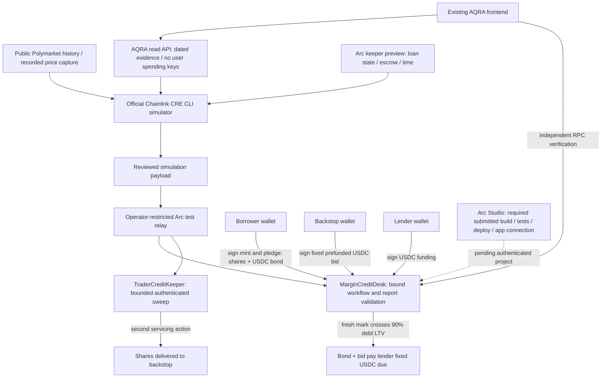

# AQRA on Arc + Chainlink CRE

## What exists and what remains

The checkout now includes the previously pushed Arc migration (`97f0446`, `17f8077`, `526ebaa`). The deployed margin desk is `0xf67bde39cf2dc4448e8da692ada233b43864788e` on Arc Testnet `5042002`. The recorded replay claims 1.02 test USDC recovery and delivery of 2.4 outcome shares. Use the verifier below to independently check those claims against the chain; static JSON alone is not proof.

The recorded Chainlink work is an **official CLI simulation** using recorded Polymarket price observations and a labeled synthetic score. A restricted operator relayed the resulting payloads to Arc. These are real testnet settlement transactions, not live Chainlink DON delivery. The score did not come from the intake workflow in that replay. The separate intake workflow source checks dated history and controllers; its simulation requires a matching real-evidence request and the AQRA read API.

**Still external/manual:** authenticated Arc Studio project, shareable URL, Studio build/test/deploy evidence and video. A completed Arc deployment outside Studio cannot be retroactively claimed as Studio-created. This repository has prior work; permitting an existing frontend does not by itself make the whole project eligible as a new event build.

## Architecture



No backend holds a borrower's key. The operator key only authenticates test reports. Monetary actions remain onchain and wallet-signed. Public Polygon positions are read-only; the escrowed shares are issued test assets on Arc. The legacy fixed-payout Floor vault remains a separate mechanism.

## Run the existing Arc application

```sh
pnpm install --frozen-lockfile
pnpm dev:arc
```

Open **http://127.0.0.1:3003/underwriting/**. Borrow uses an injected Arc wallet and supports fully funded issuance of test pairs. Lend verifies the directional replay's canonical receipts, pinned contract/relay/keeper bindings, actual loan terms, LTV breach and backstop recipient. The frontend does not invent a pool balance or approve a real loan from the test score. API port: `8789`.

The Arc profile does not need a deployer key to start. Do not give the API borrower/lender keys. Use Circle test USDC; ERC-20 balances use six decimals, while native gas USDC uses eighteen.

## Independent settlement verification — read only

```sh
pnpm arc:verify
# Optional new evidence file (refuses to overwrite an existing file):
pnpm arc:verify --output work/arc-testnet/verification.json
```

The command checks chain ID, finalized canonical receipt order, pinned runtime code, desk/relay/operator/workflow/keeper bindings, collateral/loan events, exact full recovery and early liquidation. It independently compares the lender's six-decimal ERC-20 USDC balance immediately before/after the liquidation block and the bidder/escrow ERC-1155 balances before/after delivery. An RPC without historical state support fails rather than silently dropping these checks. `ARC_TESTNET_RPC_URL` can select another HTTPS endpoint; no signer is used. These block deltas are point-in-time observations, not a general proof about unrelated transactions in the same block.

Published receipt links:

- [Funding](https://explorer.testnet.arc.io/tx/0x6a1aee7172243198bcdffb267fc7ddacd5cc930bd0dd930161834c58252565f3)
- [Liquidation/payment](https://explorer.testnet.arc.io/tx/0x6c24c3197fc52c96f45c86bbe6c3734dddf5b6f3042996b4be65cac8606e5475)
- [Share delivery](https://explorer.testnet.arc.io/tx/0x5cd10ff9b206fa6244aff3435ba01de6653c476c098bcb868569db04ccd73b39)

## Re-run CRE (separate from read verification)

Install the official CRE CLI and Bun, authenticate with CRE, and configure a local Bee/postage batch as in [TRADER_CREDIT.md](TRADER_CREDIT.md#arc-testnet). `pnpm cre:arc:demo --capture` signs new test transactions, funds disposable test actors and consumes test USDC. It requires the deployed relay's operator key (or your own separately reviewed deployment); do not run it as a harmless read check. Never commit generated test-actor keys or deployment journals.

The `arc-simulation` target and config explicitly require `arcSimulation: true`. Historical replay is allowed only in simulation with a keeper. The current Arc relay does not implement Chainlink forwarder DON verification, so a public Arc `writeReport` target is intentionally not enabled. Sepolia's separately configured CRE target still requires HTTPS evidence access and a real pinned forwarder/workflow. Do not substitute an operator relay for the DON and call it decentralized delivery.

## Arc Studio submission gate

The [official prize rules](https://ethglobal.com/events/mumbai/prizes/arc), retrieved during this review, say **Best Smart Contracts with Advanced Stablecoin Logic, In Arc Studio** accepts a new or existing frontend but requires contracts written, tested and deployed in Studio, with app connection there. All Arc prizes require the shareable Studio URL and Studio in the demo, working frontend/backend, architecture diagram, video/presentation and repository link.

Use [the handoff](../arc/README.md) and [Studio prompt](../arc/STUDIO_PROMPT.md). `pnpm arc:studio:prepare` produces a source/test snapshot with dependency licenses and SHA-256 fingerprints; it does **not** fabricate a Studio project or execute public transactions. Human sign-in and sponsor confirmation of prior-work eligibility are still required.

Before submission record:

| Gate | Required artifact |
| --- | --- |
| Event eligibility | Organizer-approved treatment of prior contracts/frontend; actual event-new commit range |
| Studio project | Actual shareable `https://studio.arc.io/...` project URL, tested from a second session |
| Studio build and tests | Reviewed source revision/settings and actual Studio test output, including negative cases |
| Studio deployment | Actual Studio-originated deployment hashes, addresses, constructor args and code hashes |
| App connection | App/API using that deployment, no mixing old replay receipts with new addresses |
| Chainlink evidence | Official CLI version/target/config and transcripts; explicit operator relay disclosure |
| Demo video | Show Studio, testnet/score/source labels, escrow, 69.76% → 406.05% LTV, lender payment and second-step share delivery |

No audit, mainnet safety, legal clearance or confirmed prize qualification is claimed.
