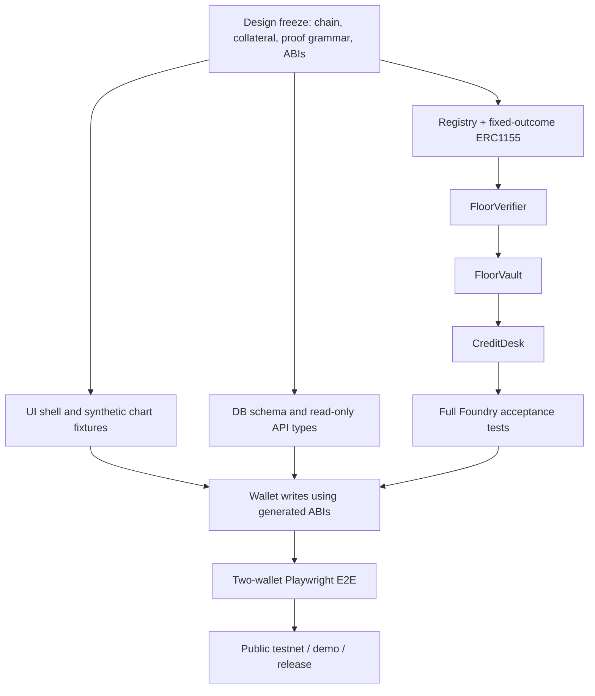

# Codex Implementation Plan, Parallel Agents and Definition of Done

**Goal:** convert this design package into a new functioning Floor Protocol repository. The provided package is *not* source code or a proof that Codex has run anything.

## 1. Delivery modes

### Mode A — hackathon vertical slice (~48 hours, high uncertainty)

A complete, narrow Compose → Verify → Lock → Fund → Settle flow on Anvil and preferably one EVM testnet, with high-quality product design and genuine wallets. **Do not** promise live external Polymarket custody, genuine institution risk underwriting, generalized theorem solvers, audits or multiple chains in 48 hours. Cut P1 items aggressively.

### Mode B — credible testnet SaaS beta (4–8 weeks, staffing dependent)

Everything in P0 plus robust oracle integration, indexer, monitoring, better data, lender quote book, analytics, deployment security and rigorous QA. Still **not** production custody readiness or automatically audited. Build quality depends on human supervision and testing, not just the number of Codex agents running.

## 2. Engineering workstreams

| Agent role | Owned paths | Contract with team | Must not modify |
|---|---|---|---|
| A. Protocol Core | `packages/contracts/src/`, Foundry tests/scripts | P0 escrow/full-set, observation registry, verifier, vault, credit and deployment JSON | UI component files |
| B. Mathematical Proof / Risk | `packages/proof-engine/`, `docs/ADR/`, fuzz test vectors | TypeScript BigInt evaluator and independent property tests; agrees with Solidity rule | Monetary Solidity after ABI freeze |
| C. Frontend / Design System | `apps/web/`, `packages/ui/` | Seven screens, data states, transaction UI, pixel-polish and responsive behavior | Solidity monetary logic |
| D. Backend / Indexer | `apps/api/`, `services/indexer/`, `db/` | Typed read API, canonical event projections, provenance, health | Wallet signing on user's behalf |
| E. Oracle / Sponsor | `services/oracle-workflow/`, CRE docs | Mock resolver test harness, optional CRE CLI successful simulation and chain write | Core ERC-1155/lending accounting |
| F. Security / Integration | `e2e/`, `scripts/preflight`, shared CI | Invariant/adversarial tests, integration E2E, demo reproducibility, incident docs | Unreviewed unilateral changes to financial formulas |
| G. Product / Research | `docs/`, `README.md`, `FEEDBACK.md` if used | Claim accuracy, disclosures, traceability, demo storyboard | Sponsor integrations it cannot substantiate |

**Merge policy:** single integration lead freezes shared ABIs and `packages/shared` Zod types before frontend/back-end implement write paths. Agents work in branches/worktrees and submit small PRs with tests. No multi-agent unsupervised shared-file collision. A test is a gate, not a decorative checkbox.

## 3. Milestones, order and acceptance

### M0 — repo foundation, 0–4 hours (P0)

- Monorepo with pnpm/turborepo, Node pinned, Foundry project, apps/web, API stubs, shared types.
- `docs/ADR-001` confirms fixed-payout ERC-1155 issuer rather than parimutuel reuse.
- `.env.example`, chain manifest, gitignore, secret scanner, basic CI and README.
- One `make dev` or documented `pnpm dev` boot path; `forge build` succeeds.

### M1 — tokenized markets and settlement, 4–14 hours

- Shared observation registry, fully backed ERC-1155 complete sets and redemption on one chain.
- Tests for mint/merge/resolve/cancel and escrow conservation; no fractional payout dust issue.
- Seed script creates observation and two markets, two demo wallets plus test USDC.
- `forge test` passes before proceeding to lending.

### M2 — proof, vault and loan engine, 14–26 hours

- `FloorVerifier.verifyPair`: same observation and policy, `YES lower + NO upper`, strict strike order, min-unit formula; fuzz and negative tests.
- Vault locks exact approved ERC-1155 inventory; cannot be double pledged or withdrawn after funding.
- Borrow request + lender funding with borrower consent, total due and buffer cap.
- Permissionless `settle` redeems both tokens and distributes lender-first payouts.
- Two different keys run test scenario including below/between/above/CANCELLED.

### M3 — premium app and backend integration, 26–38 hours

- Connect wallet, Markets, Compose, Proof Inspector, Credit Desk, Portfolio, Settlement Audit.
- Payoff curves read BigInt engine; loan write path uses generated ABIs and receipt-driven UI.
- Add Outcome Graph and precise rejection codes; no hardcoded loan status.
- Run Playwright across two wallet contexts + Anvil; integrate deterministic seed.

### M4 — public chain + sponsor + judge readiness, 38–48 hours

- Deploy and verify contract suite to ONE EVM testnet, capture tx IDs.
- Add CRE CLI simulation with actual source/time checks if not a blocker, else cut clearly.
- Capture demo walkthrough, architecture screenshot, threat model, assumptions, original source acknowledgments.
- 3 complete dry runs with clean seeded state and scripted timing. Recheck source license, event rules, and sponsor submission form.

**Stop-ship:** any untested credit invariant, falsely claimed CTF integration, or UI that shows mock settlement as an onchain repayment.

## 4. Critical path and parallelization



Only the UI shell and external research feed can progress independently before proof ABI freeze. Never fake loan behavior to unblock polished screenshots.

## 5. P0 engineering tickets with priorities

| Ticket | Priority | Depends on | Acceptance |
|---|---|---|---|
| FP-001 Initialize monorepo | P0 | none | typed workspace boots, CI builds |
| FP-002 Canonical observation registry | P0 | 001 | only after timestamp, finalize/cancel once |
| FP-003 Outcome token complete sets | P0 | 002 | funded ERC1155 split/merge/redeem |
| FP-004 Unit/quantity handling | P0 | 003 | whole-unit claim counts, 6-decimal base units |
| FP-005 Pair verifier | P0 | 002/003 | all valid interval/cancel scenarios, wrong pairs rejected |
| FP-006 Vault custody | P0 | 005 | token custody, no double lien/unfunded release |
| FP-007 Borrow request and lender funding | P0 | 006 | borrower terms, distinct lender, total debt cap |
| FP-008 Settlement waterfall | P0 | 007 | correct $2 and $1 and cancel cases |
| FP-009 Shared types / ABI generation | P0 | 002–008 | no hand-maintained ABI drift |
| FP-010 Composer and proof frontend | P0 | 005/009 | scenario chart and onchain proof agree |
| FP-011 Credit and wallet UI | P0 | 007/009 | two wallet signed onchain funding |
| FP-012 Portfolio and audit read UI | P0 | 008/009 | real events with tx links |
| FP-013 Foundry and Playwright suite | P0 | 003–012 | all required tests pass |
| FP-014 Deploy and seed | P0 | 013 | public chain test and receipt evidence |
| FP-015 CRE workflow | P1 / bounty | 002/014 | actual CLI simulation integrates data + blockchain |
| FP-016 Polymarket read-only adapter | P1 | 001 | real data correctly tagged research-only |
| FP-017 Generalized proof engine | P1 | 005 | computed min across intervals verified onchain |
| FP-018 Tranche issuance against proof | P2 | 008 | real onchain tokenized senior/junior; anti-double pledge |

## 6. Ready-to-copy Codex master prompt

```text
You are the principal engineer and integration lead for FLOOR PROTOCOL.
Read README.md, AGENTS.md, and ALL docs in docs/ BEFORE editing code.
This is an original greenfield Ethereum/EVM app inspired by public Senthos and
Cumulant architecture, not a clone or redistribution of their source.

Deliver a functioning, beautiful, testnet-first full-stack DApp with one full
Compose -> Verify -> Lock -> Fund -> Settle flow, matching the provided PRD,
contract spec, mechanism proof and security acceptance tests.

PHASE 0: Audit specifications for contradictions, create ADRs and a
prioritized backlog. Report blockers with explicit decisions. Then initialize
pnpm + Next.js + Foundry monorepo. Use only one chain and six-decimal mock USDC.

CORE RESTRICTIONS:
- DO NOT implement fixed payout proof on a parimutuel market.
- DO NOT allow semantic AI scores to certify a floor.
- DO NOT accept external CTF collateral without real custody verification.
- DO NOT put wallets or economic state in browser mock reducers.
- DO NOT use fake onchain balances or mark simulation as real.
- DO NOT introduce a collateral token other than approved 6-decimal mock USDC.
- DO NOT allow debt+fees above verifier floor minus required buffer.
- DO NOT imply position profit is guaranteed or floor is immediately liquid.

Build outcome tokens with fully funded ERC1155 complete sets, shared scalar
registry with finalization/cancel, pair verifier, locked vault, borrower-approved
loan request, distinct lender funding, and redeemed-cash lender-first waterfall.

Treat all pre-existing Senthos/Cumulant work as inspiration and citations,
not code to copy. Observe ETHGlobal track timing rules.

WORKFLOW: write contract tests and proof fuzzing first; generate typed ABIs;
parallelize UI/read API only after freezing contract interfaces; end with
Foundry invariant suite, two-wallet Playwright E2E, deployment scripts and
reproducible demonstration. Report each phase with: implemented files,
tests executed, pass/fail output, remaining mocks, security risks and next tasks.
Do not claim success unless an end-to-end onchain transaction is observed.
```

## 7. Specialized Codex agent prompts

### Protocol agent

```text
Own packages/contracts only. Implement registry, fully collateralized
fixed-outcome ERC1155, factory, verifier, vault and matched credit desk exactly
as CONTRACT_SPEC.md and MECHANISM_AND_PROOFS.md. Start with tests exposing
reversed-strike, mismatched-observation, cancel, empty claim, double lien,
high due, reentrancy and double settlement failures. Build a deploy-local script,
ABIs and gas report. Do not modify web UI or skip revert-case tests.
```

### Proof agent

```text
Own packages/proof-engine and reference test fixtures. Implement pure BigInt
payout computations with all price boundary and shared CANCELLED cases. Fuzz
qLower and qUpper and verify minimum=min(qLower,qUpper)*1e6. Generate JSON
vectors for contract tests. Make no assumptions from question text or ML.
```

### UI agent

```text
Own apps/web. Implement an unusually polished financial risk terminal per
FRONTEND_UX.md using Next.js, Tailwind, shadcn/ui, React Flow and ECharts.
Build the Composer, exact discrete payoff step chart, Proof Inspector, Credit
Desk and Settlement Audit with accessible interactions. Stub *read fixtures*
only until ABIs are frozen. Wire all financial writes to wagmi/viem transactions.
Visible demo labeling and proof assumptions are mandatory. Maintain Playwright
selectors and responsive/mobile behavior.
```

### Data/indexer agent

```text
Own apps/api, services/indexer and db. Implement only read-side projections;
chain is canonical. Zod schemas and reorg-safe (blockHash) cursor. Make read-only
Polymarket Gamma adapter optional and segregate its data from eligible collateral.
Expose provenance and stale flags. Never hold or use a user-spending key.
```

### Security/integration agent

```text
Own e2e, test scripts, CI and release gates. Run 2-wallet Anvil sequence:
0.75 USDC principal, 0.78 fixed due, 1 USDC certified floor; middle price
gets 2 total, lower/upper/outside and shared cancel get 1. Check direct
balance deltas and logs. Attempt double pledge, wrong observation, stale
request, reentrant receiver and premature oracle. Report failures clearly.
```

### CRE agent

```text
Own services/oracle-workflow. Read official Chainlink CRE docs and Mumbai
bounty requirements, implement one meaningful external scalar price data
workflow with timestamp/precision guards and blockchain state write or CLI
simulation. Capture complete CLI logs and actual onchain integration points.
Do not label a mocked HTTP price as a decentralized production oracle.
```

## 8. Machine-checkable acceptance gates

`pnpm lint` clean. `pnpm typecheck` clean. `forge build` and all Foundry tests clean. 6+ payment boundary assertions. `pnpm e2e` passes with fresh local Anvil. `scripts/demo-preflight` confirms chain, contract addresses, test USDC, oracle, lender wallet, seed balances and supported asset. Demo screenshot or recording captured after successful receipt. Failed test should fail CI rather than be muted.

## 9. Decision log / progress reporting template

```markdown
### Day / milestone status
- Commit SHA / branch:
- Source changes:
- Onchain contracts deployed? addresses / chain ID:
- Tests run: commands, pass/fail counts:
- User-visible screens that use real onchain state:
- Mock or unimplemented features:
- New security risks / deviations from spec:
- Next critical dependency:
- Artifacts / explorer receipts:
```

## 10. Post-hackathon roadmap (4–8 weeks)

- **Week 1:** complete replayable indexer, wallet-side error UX, complete spec/test docs and chain verify.
- **Week 2:** CRE workflow hardened with real data source, rate limits and independent price validation; timestamp/liveness audit.
- **Week 3:** lender RFQ, loan book, EIP-712, loan request expiries, settlement monitoring and alerting.
- **Week 4:** generalized 2–8 threshold-leg interval verifier and bounded proof evaluator; adversarial gas/performance tests.
- **Weeks 5–6:** structured proof-backed senior/junior positions with lien-exclusion invariant; optional real market adapter feasibility and cost study.
- **Weeks 7–8:** external review, legal/jurisdiction assessment, security remediation, performance monitoring, institutional API pilot. **Do not skip independent audit and real-life settlement tests before financial launch.**

## 11. Submission and pitch artifacts

Public repo (if allowed), README, architecture diagram, FEATURES_AND_LIMITATIONS.md, demo video, 2–4 minute testnet transaction flow, signed wallet screenshots, deployment addresses, Foundry test output, CRE simulation proof if pursuing Chainlink, Arc Studio URL if pursuing Arc, proper ETHGlobal prior-work disclosures and actual sponsor forms. Separate demonstrated results from aspirational product roadmap.
