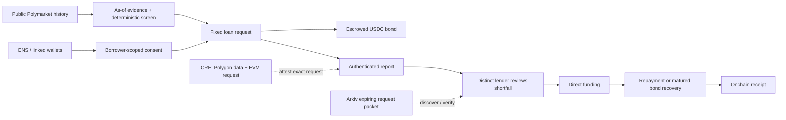

# AQRA — ETHGlobal Mumbai submission brief

**Status date:** 6 November 2026. This brief describes the current AQRA trader-credit app, not the earlier Floor Protocol terminal.

## One-line pitch

**AQRA is a prediction-market performance-metrics-based lending protocol: it scores dated trader history to gate a bonded loan request, then lets a lender verify the attested metrics and choose whether to fund.** The score is not a repayment model or collateral.

## Submission description

Prediction-market traders can expose public, settled trading history, but that history is not a credit record. AQRA uses activity, repeat profitability, realized P&L efficiency and drawdown as explicit underwriting metrics. A qualifying borrower posts a USDC bond; the lender reads the dated inputs, checks that their digest matches the attested report, and chooses whether to accept the uncovered loss. The benchmark tests future trader P&L—not repayment—and pooled lending stays rejected until real loan outcomes and committed capital exist.

## The mechanism

### Four application destinations

1. **Data:** sampled market coverage, walk-forward policy comparison, address-level underwriting metrics and export.
2. **Risk engine:** assumption-driven credit loss and discrete portfolio stress. It rejects pool underwriting because the model has no loan labels or committed reserve.
3. **Borrow:** wallet/ENS discovery, as-of evidence, scoped linked-wallet consent, fixed terms and bond escrow.
4. **Lend:** request review, loss acknowledgement, direct funding, borrower repayment or matured default, with receipts.

## What the data says

The checked-in sample spans November 2025 through October 2026. It schedules 768 BTC/ETH 15-minute sessions; 764 markets were captured as resolved. The artifact includes 3,906 wallet histories, 3,647,433 fill rows, 1,025,654 daily P&L observations, 15 of 15 verified month-boundary blocks, 6,155 candidate wallet-month rows and 11 completed forward rounds.

| Selection rule | Positive following-month P&L | Sample size |
| --- | ---: | ---: |
| Consistency screen | 154 / 220 · 70.0% | 220 wallet-months |
| Largest monthly P&L | 162 / 220 · 73.6% | 220 wallet-months |
| 10× to below 100× settled buy | 55 / 160 · 34.4% | 160 wallet-months |
| At least 100× settled buy | 2 / 4 · 50.0% | 4 wallet-months |
| Seeded sample baseline | 61 / 220 · 27.7% | 220 wallet-months |

The consistency screen is 42.3 percentage points above the seeded baseline and 3.6 points below the simple largest-monthly-P&L comparator. Wallet-month observations can repeat addresses. Discovery, survivorship, market regime and source-coverage bias remain. This is evidence to test a screening hypothesis; it is **not** repayment evidence, credit lift, borrower PD, lender yield, return on equity or a causal result.

## Loan economics and the honest risk statement

Current demo terms are $100 principal, $102 total due and $25 posted bond. If the borrower defaults and the entire bond is recovered, up to $75 of principal remains unpaid. A token, contract or operational failure can make recovery lower. The lender knowingly takes that risk; there is no pool, guarantee, seized trading position or right to future trading profits.

The risk engine lets a user vary assumed PD, default dependence, recovery haircut, tail confidence, costs and scenario capital. These are not measured loan statistics. The pooled-credit gate remains `REJECT` until AQRA has matured repayment/default labels, calibrated and out-of-time-validated PD, and genuinely committed loss capital.

## Demo sequence

1. Show the benchmark sample counts and the five observed cohort rates. Point out that the strongest simple comparator is 3.6 points above the consistency screen.
2. Change one risk assumption and show loss distribution, VaR/ES and the unchanged `REJECT` gate.
3. On Anvil 31337, create a request from the captured sample using the explicit local-only borrower impersonation tool. Show the request transaction and exact terms.
4. Use the local curator to submit the report; distinguish it from CRE.
5. Switch to a distinct lender, load the request's activity, P&L, turnover, efficiency and drawdown; show the evidence digest matches the attested report.
6. Inspect the $75 shortfall, acknowledge the risk and fund with test USDC.
7. Repay using the borrower flow, or show the matured-default path if the event state is prepared. End on receipt-backed state.
8. If a Rabdi testnet write/read is completed, show `Discover on Arkiv` and verify packet claims against the request. If not, omit Arkiv from the live demo.
9. For the CRE bounty, run and show the successful official `cre workflow simulate` output with Polygon API reads and the local EVM request. Do not label this a public DON write.

## Sponsor readiness

| Sponsor path | Assessment on 6 November |
| --- | --- |
| **Chainlink CRE** | Closest fit. The workflow source is present and connects an external Polygon/Polymarket API with the EVM request. No successful official CLI simulation or live workflow is yet recorded. Complete that exact demo gate. |
| **Arkiv existing projects** | Code path exists for an expiring request packet and a lender-visible query, but no public receipt or new event-work evidence is recorded. Existing-project prize requires Continuity registration; the team is unsure whether it has it. Confirm before claiming this track. |
| **Arc** | No Arc integration exists here. Every Arc prize requires an Arc Studio-originated project, a shareable Studio project URL and showing Studio in the demo, plus a working app/backend, architecture diagram and presentation. Arc Continuity additionally requires Continuity registration. Do not claim Arc eligibility yet. |

Official requirements: [ETHGlobal Mumbai prizes](https://ethglobal.com/events/mumbai/prizes), [Arc prizes](https://ethglobal.com/events/mumbai/prizes/arc), [Chainlink CRE](https://docs.chain.link/cre), [Arkiv Rabdi](https://docs.arkiv.network/networks/rabdi/).

## Judge proof bundle

- Public repository with install/run steps, current four-screen scope and explicit limitations.
- Fixed-schedule benchmark artifact, source capture manifest and exact cohort table.
- Contract addresses, code identity, chain ID, transaction hashes, event indices and before/after test-USDC balances for the recorded demo.
- A CRE simulation transcript and workflow config with credentials removed; separately record any public DON transaction if one later exists.
- If entering Arkiv: writer address, entity schema/expiry/ownership, reproducible query, transaction/entity key, user-facing read receipt and the required criterion files.
- If entering Arc: shareable Studio project URL, functional Arc flow, architecture diagram and video showing Studio.
- A short video, under the applicable event limit, showing the whole core flow and one fail-closed condition.

## Submission guardrails

- Say **prediction-market performance-metrics-based lending**, **policy-gated borrower request**, **bond-backed direct loan**, and **lender-accepted shortfall**.
- Do not say that trader history predicts repayment, that the 70% outcome is credit accuracy, or that the loan is safe because of the bond.
- Do not describe the local impersonation demo as real borrower consent or real funds.
- Do not describe a CRE simulation as a live oracle write, an Arkiv code path as a confirmed transaction, or the current repo as an Arc project.
- Treat registration in ETHGlobal's Continuity program as unknown until the team verifies it.
