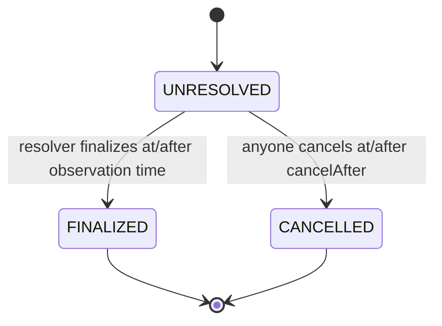

Each observation records `assetId`, `observationTime`, `priceDecimals`, `sourceId`, `resolutionPolicyHash`, `cancelAfter`, state, price and immutable resolver. The curator registers it before its timestamp. The required policy is:

```text
keccak256("FLOOR_SHARED_GEQ_50_50_V1")
```

All child markets derive payout from the same registry record. There is no per-market price override or independent cancellation path.



Finalization and cancellation are terminal and cannot overwrite one another. At or after the longstop, a still-unresolved observation may be finalized or canceled; the first successful transaction wins. Cancellation applies 50/50 to every tied YES/NO claim.

## Economic cutoff

New market creation, mint, merge, verification/lock, borrow requests and funding stop at the observation timestamp even if the resolver has not reported yet. This prevents information available after maturity from being used to open a new credit position.

Unfunded release, full repayment and terminal redemption/settlement are distinct exit paths and do not depend on creating new exposure.

## Resolver models

- **Local Anvil:** immutable trusted test resolver account may submit any bounded canonical unsigned price after maturity. This is explicitly a demo trust model.
- **Sepolia path:** registry resolver is the historical Chainlink adapter. Anyone may submit the round witness, but cannot choose an arbitrary price. See [oracle integration](/developers/oracles).
- **CRE preparation:** produces unsigned calldata only. It does not authenticate an external source or represent a deployed workflow.

A source label/hash is a commitment, not proof that a resolver told the truth. Structural payout support does not ensure fair upside allocation.
