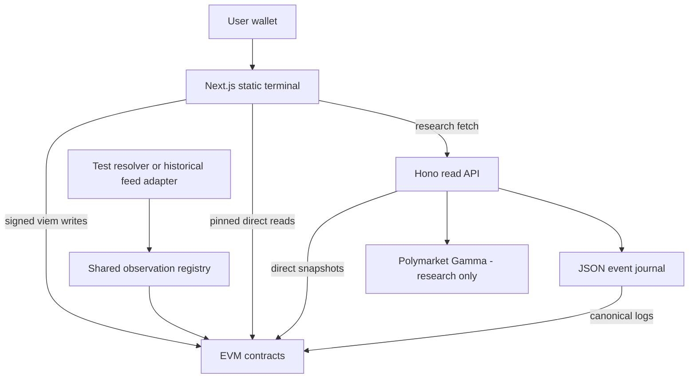
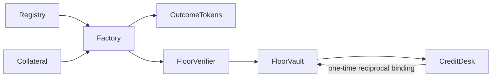

## Repository map

| Path | Responsibility |
| --- | --- |
| `packages/contracts/src` | Solidity 0.8.30 claims, registry, proof, custody, credit and feed resolver |
| `packages/contracts/test` | Protocol, adversarial, repayment, resolver, actual-redemption fuzz and stateful invariants |
| `packages/proof-engine/src` | Exact BigInt parsers, pair payout/floor, debt cap and research sweep |
| `packages/shared/src` | Generated ABIs, deployment/snapshot types, pinned chain reads, eligibility and feed witnesses |
| `apps/web/src` | Next.js/React terminal, viem wallet transport, charts and semantic CSS |
| `apps/api/src` | Read-only Hono routes, deployment-generation loader and research adapter |
| `services/indexer` | Durable JSON canonical-block journal with orphan retention |
| `services/oracle-workflow` | Unsigned report preparation; not a live CRE workflow |
| `scripts` | Foundry wrapper, deployment, ABI generation, preflight, replay, differential checks and packaging |
| `e2e` | Separate-wallet Chromium lifecycle, offline, interaction and visual checks |
| `evidence` | Historical receipts, verification results, logs and screenshots |
| `docs` | Original blueprint plus this Mintlify documentation source |

## Onchain dependency graph

The factory deploys its issuer. The optional historical adapter deploys its own registry. Vault/desk references are pinned; no upgradeable proxy mechanism exists in original protocol contracts.

## Implemented, not proposed

This release uses **viem**, Hono, direct RPC snapshots and a persistent **JSON journal**. It does not implement the blueprint's wagmi/Drizzle/PostgreSQL stack, production normalized projections or a backend quote book. The journal is secondary and API financial collections currently use direct snapshots, not journal projections.

Monetary state lives only onchain. The API has no spending route. Browser proof results and research models cannot authorize inventory or change a loan's debt cap.
