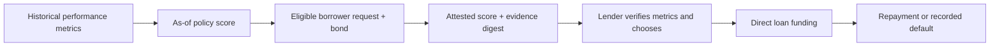

AQRA is a prediction-market performance-metrics-based lending protocol pilot. Its dated activity, realized P&L, repeat profitability and drawdown policy gates bonded loan requests. A separate lender reviews the report and decides whether to fund.

<Warning>
This is a local/testnet prototype using test funds. The metrics are not validated repayment predictors or collateral. The lender can lose principal beyond the borrower bond.
</Warning>

<CardGroup cols={2}>
  <Card title="Data" icon="chart-line" href="/status">Review the current replay, coverage and implementation status.</Card>
  <Card title="Whitepaper" icon="file-text" href="/whitepaper">Read the product design, benchmark method and limits.</Card>
  <Card title="Run the demo" icon="terminal" href="/quickstart">Start the local chain and walk through a real test-fund loan.</Card>
  <Card title="Borrow and lend" icon="wallet" href="/guides/borrow">Review wallet consent, bond terms and lender actions.</Card>
</CardGroup>

## Credit flow

The policy controls whether a borrower can request a pilot loan; it does not set pricing, approve the lender's advance or infer default risk. The lender loads the linked wallets' dated metrics and the app verifies that their digest matches the attested score. The first-loss bond is the only pledged asset. The benchmark's forward outcomes are trader P&L and activity, not loan returns. The risk engine uses explicit PD and correlation stress assumptions.

## Evidence boundaries

Polymarket public P&L provides wallet-level realized performance, turnover and trade counts. It does not provide the trader’s complete account equity or starting bankroll, so it cannot establish ROI.

ENS helps discover associated addresses, while linked controllers provide scoped consent. Chainlink CRE workflow code and an Arkiv packet path are available, with local and public execution states labeled separately. See the [whitepaper](/whitepaper) for benchmark assumptions and integration status.
