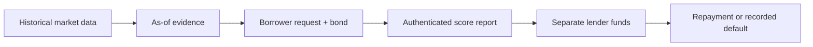

AQRA evaluates public, settled Polymarket history before a separate lender funds a small fixed-term request. Wallet consent and a borrower-funded bond are recorded with the request.

<Warning>
This is a local/testnet prototype using test funds. A performance score does not guarantee repayment. The lender can lose principal beyond the borrower bond.
</Warning>

<CardGroup cols={2}>
  <Card title="Data" icon="chart-line" href="/status">Review the current replay, coverage and implementation status.</Card>
  <Card title="Whitepaper" icon="file-text" href="/whitepaper">Read the product design, benchmark method and limits.</Card>
  <Card title="Run the demo" icon="terminal" href="/quickstart">Start the local chain and walk through a real test-fund loan.</Card>
  <Card title="Borrow and lend" icon="wallet" href="/guides/borrow">Review wallet consent, bond terms and lender actions.</Card>
</CardGroup>

## Credit flow

The current trader-credit desk does not custody Polymarket positions. Trading history supports screening research, and the first-loss bond is the only pledged asset. Forward outcomes are observed trader P&L and activity, not loan returns. The risk engine uses explicit PD and correlation stress assumptions; it does not infer default risk from trading history.

## Evidence boundaries

Polymarket public P&L provides wallet-level realized performance, turnover and trade counts. It does not provide the trader’s complete account equity or starting bankroll, so it cannot establish ROI.

ENS helps discover associated addresses, while linked controllers provide scoped consent. Chainlink CRE workflow code and an Arkiv packet path are available, with local and public execution states labeled separately. See the [whitepaper](/whitepaper) for benchmark assumptions and integration status.
