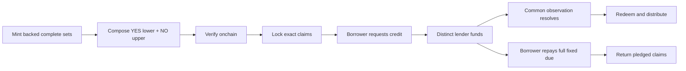

AQRA is the terminal for **Floor Protocol**, an independently implemented outcome-collateral and matched-credit prototype. Its restricted pair proof bounds terminal contractual payouts; contracts enforce backing, custody, borrower consent and lender-first settlement.

<Warning>
Test funds only. Independently unaudited. A contractual settlement floor is not a resale price, guaranteed profit, immediate liquidity, insurance or legal clearance.
</Warning>

<CardGroup cols={2}>
  <Card title="Run the application" icon="terminal" href="/quickstart">Start the local EVM, API and terminal.</Card>
  <Card title="Understand the proof" icon="shield" href="/concepts/payout-floor">Check every price boundary and shared cancellation.</Card>
  <Card title="Borrow against claims" icon="wallet" href="/guides/borrow">Lock actual inventory and publish consented terms.</Card>
  <Card title="Build an integration" icon="code" href="/developers/architecture">Inspect source-derived contract and HTTP references.</Card>
</CardGroup>

## The lifecycle

For one YES claim at 5,000 and one NO claim at 6,000 sharing the same observation, the terminal payout is 1 or 2 test USDC; shared cancellation pays 1. The sample loan advances 0.75 and owes a fixed 0.78, including fees.

## Read the right evidence

The implemented local lifecycle, public read-only Sepolia checks, pinned Sepolia fork and recorded offline terminal are different execution modes. **No public protocol deployment receipt or live CRE write is supplied by this release.** See [implementation status](/status) and [release evidence](/operations/evidence).

The original specifications are preserved under [Specifications](/specifications/index). They include historical proposals; current pages document the checked-in source, not every original aspiration.
