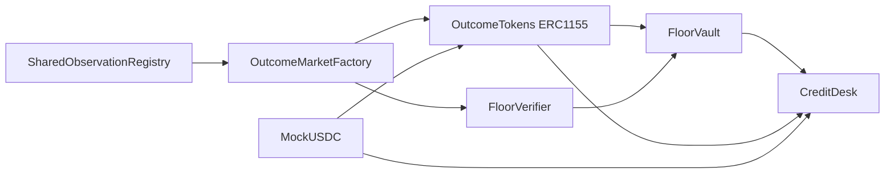

<Warning>
Preserved source document. Status, interface examples and proposals are historical where noted; consult the current guides and source-derived references before integration. This page is generated, not a new execution or audit claim.
</Warning>

[Original Markdown source](https://github.com/debojyoti10CC/floorprt/blob/main/docs/CONTRACT_SPEC.md) · [Current documentation scope](/maintenance/source-audit)


**Target:** Solidity 0.8.x / Foundry / OpenZeppelin. All interfaces here are DESIGN signatures; exact compilation and ABIs must be generated by Codex, never represented as already deployed.

## 1. Modules and build dependencies



- `MockUSDC.sol` — ERC-20 six-decimal test collateral and faucet (TESTNET ONLY).
- `SharedObservationRegistry.sol` — immutable scalar observation metadata; `UNRESOLVED → FINALIZED(price)` or `UNRESOLVED → CANCELLED` once.
- `OutcomeMarketFactory.sol` — approved creation of binary `GEQ` markets tied to registry observations.
- `OutcomeTokens.sol` — ERC-1155 fully escrow-backed complete-set creation, merge and redemption.
- `FloorVerifier.sol` — price-independent minimum payout verification for exact supported pair.
- `FloorVault.sol` — ERC-1155 custody and inventory accounting; one lien per position; unlock path.
- `CreditDesk.sol` — matched lender funding, fixed repayment, settlement waterfall, position status.
- `DemoOracleAdapter.sol` — limited test-only role; later replaced or restricted by authorized CRE adapter.

## 2. SharedObservationRegistry

**Observation fields:** `id`, `assetId` (keccak256 of canonical symbol/source/quote), `observationTime`, `priceDecimals`, `sourceId`, `resolutionPolicyHash`, `cancelAfter` (deadline/grace), `state`, `price`, `resolver`. Immutable metadata after creation. Registry `createObservation` curator-only; `finalize(id,price)` permitted to authorized resolver only when block time ≥ observationTime and state=UNRESOLVED; reject negative price, out-of-range normalization; `cancel(id)` after configured grace with a defined trusted or permissionless longstop condition, under P0 tested shared cancellation policy. Every child market reads registry state. No market-specific override.

Possible ABI:

```solidity
enum ObservationState { UNRESOLVED, FINALIZED, CANCELLED }
function registerObservation(bytes32 assetId, uint64 observationTime, uint8 priceDecimals,
  bytes32 sourceId, bytes32 resolutionPolicyHash, uint64 cancelAfter)
  external returns (uint256 observationId);
function finalize(uint256 observationId, uint256 canonicalPrice) external;
function cancel(uint256 observationId) external;
function observation(uint256 observationId) external view returns (Observation memory);
```

**Critical:** A sourceId label is insufficient evidence of real oracle quality. Registry access-control and external-data validation are explicitly trusted P0 rails. For a public implementation use a verified data-feed bridge and documented dispute/cancellation policy.

## 3. OutcomeMarketFactory + OutcomeTokens

**Market metadata:** `marketId`, `observationId`, `strike`, `predicate=GEQ`, `outcomeTokenContract`, `settlementToken`, `payoutPolicyVersion`, `yesTokenId`, `noTokenId`, `creationBlock`, `enabledForNewCollateral`. Market metadata immutable after creation. Pausing new collateral should not invalidate claims already outstanding.

Suggested `yesTokenId = marketId * 2 + 1`, `noTokenId = marketId * 2 + 2` (or a collision-safe hash with market and side); verify no collision and use one canonical mapping.

```solidity
function createMarket(uint256 observationId, uint256 strike)
  external returns (uint256 marketId);
function getMarket(uint256 marketId) external view returns (Market memory);
function mintCompleteSet(uint256 marketId, uint256 wholeUnits) external;
function mergeCompleteSet(uint256 marketId, uint256 wholeUnits) external;
function redeem(uint256 marketId, Side side, uint256 wholeUnits) external returns (uint256 paid);
function redeemFor(uint256 marketId, Side side, uint256 units, address recipient)
  external returns (uint256 paid);  // restrict to token holder/authorized operator
```

**Core invariant per market:** every `mintCompleteSet(M,q)` takes exactly `q*1e6` USDC and mints `q` YES + `q` NO. `mergeCompleteSet` burns equal whole units and returns `q*1e6` before resolution. After resolution, `redeem` burns claim units and pays fixed (1e6, 0 or 5e5 per unit). All user grants are explicit ERC-1155 operator approvals; `redeemFor` cannot transfer/burn third-party claims without ERC-1155 approval and owner/recipient validation. Use `SafeERC20`, `ReentrancyGuard`, CEI, and ERC-1155 receiver checks.

**Prevention of fake mint:** only contract `mintCompleteSet` has mint role and it must pull fully backed collateral. Admin cannot mint claims for free. `MockUSDC` test faucet should be separate and visually named as such.

**Issue:** ERC-1155 transfers to a vault should happen through `lockPair()` using batch safe-transfer (with approval). The vault receiver must only accept the known transfer context to avoid accounting orphan tokens.

## 4. FloorVerifier

```solidity
struct VerifiedFloor {
  bool valid;
  uint256 floorUsdcBase; // 6 decimal
  uint256 observationId;
  bytes32 proofVersion;
  uint16 reasonCode;
}
function verifyPair(uint256 marketLower, uint256 marketUpper,
  uint64 unitsYesLower, uint64 unitsNoUpper)
  external view returns (VerifiedFloor memory);
```

Rules: same factory/token issuer/collateral/policy/observation; `GEQ` predicate; `lowerStrike&lt;upperStrike`; selected sides exactly `YES lower`, `NO upper`; positive whole unit counts; supported registry state and contract version. `floorUsdcBase = min(units)*1_000_000`. If observation already finalized, newly borrowing should be blocked even though cashout is known; settlement can still proceed on previously locked loans. Only use chain-queried metadata; calldata must not specify arbitrary oracle/strike without verification.

**Invariant:** for every accepted pair and every allowed numeric observation (plus shared CANCELLED), actual redeemable cashflow ≥ certified floor. See MECHANISM_AND_PROOFS.

## 5. FloorVault

Position:

```solidity
enum PositionState { NONE, OPEN, ENCUMBERED, RELEASED, REDEEMED }
struct Position {
  address owner;
  address beneficiary;
  uint256 marketLower;
  uint256 marketUpper;
  uint64 unitsLower;
  uint64 unitsUpper;
  uint256 observationId;
  uint256 certifiedFloor;
  PositionState state;
  uint256 lienLoanId; // 0 => none; offset id convention
}
```

```solidity
function lockPair(uint256 lowerMarket, uint256 upperMarket,
  uint64 unitsLower, uint64 unitsUpper, address beneficiary)
  external returns (uint256 positionId);
function releaseUnfunded(uint256 positionId) external;
function markEncumbered(uint256 positionId, uint256 loanId) external; // only CreditDesk
function redeemLocked(uint256 positionId)
  external returns (uint256 redeemedAmount);  // only CreditDesk, when resolved
function getPosition(uint256 positionId) external view returns (Position memory);
```

- `lockPair` checks verifier *in the same tx*, registers transfer context, and pulls both ERC-1155 positions atomically.
- `releaseUnfunded`: only owner, state OPEN, no active lien; returns same IDs and quantities.
- `markEncumbered`: only `CreditDesk`, once; verify position current OPEN and lender funding exists in same external credit transaction.
- `redeemLocked`: only CreditDesk, state ENCUMBERED, common observation terminal, burns/redeems exact tokens, receives exact USDC (balance-delta check), changes state before transferring cash to desk.
- `beneficiary` immutable or safely owner-approved before loan; cannot be changed after funding.
- No admin removal or reuse of pledged tokens.

## 6. CreditDesk

Loan:

```solidity
enum LoanState { NONE, FUNDED, SETTLED, REPAID_EARLY }
struct Loan {
  uint256 positionId;
  address lender;
  address borrower;
  uint256 principal;
  uint256 due; // principal + fixed fee; 6-decimal base units
  uint256 certifiedFloor;
  uint64 fundedAt;
  uint64 targetMaturity;
  LoanState state;
}
```

**MVP lending flow options:** select ONE for implementation. Recommended direct onchain `fundLoan(positionId, principal, totalDue, expiry)` called by the **lender**, with borrower-preapproved terms set in `FloorVault` or a borrow request mapping. Without borrower approval, do not permit lender to impose arbitrary fee to encumber someone else's collateral. Create `requestLoan(positionId, maxPrincipal, maxDue, offerExpiry)` by borrower; lender `fundLoan` must satisfy borrower constraints; expiry and exact loan terms recorded. Alternative EIP-712 borrower-signed offer belongs to P1.

```solidity
function requestLoan(uint256 positionId, uint256 requestedPrincipal,
  uint256 maximumDue, uint64 requestExpiry) external;
function cancelRequest(uint256 positionId) external;
function fundLoan(uint256 positionId, uint256 principal, uint256 totalDue)
  external returns (uint256 loanId);
function settle(uint256 loanId) external;
function getLoan(uint256 loanId) external view returns (Loan memory);
```

**Funding execution:** validate position OPEN and requested by owner, request not expired, observation unresolved, `principal &gt; 0`, `due &gt;= principal`, `due &lt;= maxDue`, `due &lt;= certifiedFloor - ceilDiv(certifiedFloor*bufferBps,10_000)`. Mark position ENCUMBERED before transfer; transfer principal USDC directly from lender to borrower (atomic revert if transfer fails); emit `LoanFunded`.

**Settlement:** check registry terminal; mark loan SETTLED and position REDEEMED *before external* redemption as CEI; redeem both locked ERC-1155 token lots; read exact USDC received; send `due` to lender, remainder to beneficiary; verify at least due, otherwise revert and preserve state for incident handling. Use a `settle()` permissionless function. `settle` should not strand funds if the borrower/lender is a contract whose ERC-20 transfer semantics are unusual; settlement token allowlist required.

**Loan number ids and lien ids:** fix a single zero/none convention; block accidental reuse. Do not rely on `block.timestamp` for loan amount escalation.

**Liquidations:** explicitly **none** in P0 because terminal floor and fixed repayment substitute for margin liquidation; unresolved oracle delays still create liquidity and time risk. No price oracle or keeper liquidation is needed to enforce the restricted payout floor.

## 7. Supported cancellation and emergency semantics

The registry may move **the common** observation to CANCELLED only under precommitted time/authority rules. Each child market uses a 50/50 split at cancellation. A user holding YES lower and NO upper still receives `$1` per matched pair of whole units. Do not copy Cumulant-style void refund behavior without checking how it interacts with third-party token holders and lender rights; unilateral market void is prohibited for eligible collateral.

An emergency pause may block **new** market creation and new loans but must not arbitrarily block legitimate repayment forever. Production versions require multisig and transparent liveness criteria, not a sole server key.

## 8. Events required for indexer and UX

```solidity
event ObservationRegistered(uint256 indexed observationId, bytes32 indexed assetId, uint64 observationTime);
event ObservationFinalized(uint256 indexed observationId, uint256 price);
event ObservationCancelled(uint256 indexed observationId);
event MarketCreated(uint256 indexed marketId, uint256 indexed observationId, uint256 strike);
event CompleteSetMinted(uint256 indexed marketId, address indexed user, uint256 units, uint256 collateral);
event CompleteSetMerged(uint256 indexed marketId, address indexed user, uint256 units, uint256 collateral);
event ClaimRedeemed(uint256 indexed marketId, address indexed user, uint8 side, uint256 units, uint256 payout);
event VaultPositionCreated(uint256 indexed positionId, address indexed owner, uint256 floorUsdc);
event VaultPositionReleased(uint256 indexed positionId);
event BorrowRequested(uint256 indexed positionId, address indexed borrower, uint256 requestedPrincipal, uint256 maxDue);
event LoanFunded(uint256 indexed loanId, uint256 indexed positionId, address indexed lender, address borrower, uint256 principal, uint256 due);
event LoanSettled(uint256 indexed loanId, uint256 redeemed, uint256 lenderPaid, uint256 borrowerPaid);
```

## 9. Canonical invariants / mandatory tests

1. **Backing:** total potential cash due from outstanding YES/NO token claims for any market resolution ≤ its USDC escrow.
2. **Conservation:** escrow reduction exactly matches merged claims or successfully redeemed claim payouts; no double redemption.
3. **Proof:** any eligible pair pays at least verified floor for price ≤lower, exactly lower, strictly inside, exactly upper, ≥upper, CANCELLED; fuzz wide strike/quantity domains.
4. **No cross-condition fraud:** differing observations, price scale, asset, collateral, oracle policy, contract code, payout semantics or reversed strikes reject.
5. **Collateral lien:** no double pledge; no release after funding; no ownership/beneficiary substitution post-lien.
6. **Credit solvency:** total due (including fees) never exceeds floor minus mandatory buffer; no amount-dependent overflow.
7. **Waterfall:** lender first, borrower residual; two `settle()` calls can never pay twice.
8. **Monotonic state:** terminal registry states immutable; loan state never returns from SETTLED to FUNDED.
9. **Atomicity:** failed ERC-20 approval/transfer or ERC-1155 callback reverts all related debt/inventory writes.
10. **Access control:** only vetted resolver can finalize; public cannot admin-mint or alter registry metadata.
11. **Time guard:** can't finalize before observation time; clear cancellation-after policy.
12. **Funded-before-resolution:** reject loan funding after observation resolved or cancellation finalized.
13. **Cancellation rounding:** whole ERC-1155 units produce exact 0.5 payout in six-decimal USDC.
14. **No backend privileged spending:** server never holds borrower private key and cannot withdraw user's locked collateral.
15. **Test-only conditions:** mock faucet not deployed/usable as 'production USDC'; per-chain address validation.

## 10. Invariants from source repos worth adapting

Cumulant contains market solvency fuzz, tranche waterfall tests, note principal-bound fuzz and security cases for void/liveness, creator griefing and missing outcomes; Senthos has account/PDA authority and Solana onchain vault reviews and candid notes on simulated lending. These provide **test categories**, not reusable fixed-outcome proof logic. See SOURCE_AUDIT for exact files and how their mechanisms differ.
