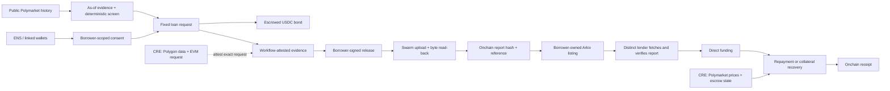

<Warning>
Preserved source document. Status, interface examples and proposals are historical where noted; consult the current guides and source-derived references before integration. This page is generated, not a new execution or audit claim.
</Warning>

[Original Markdown source](https://github.com/debojyoti10CC/floorprt/blob/main/docs/ETHGLOBAL_SUBMISSION.md) · [Current documentation scope](/maintenance/source-audit)

**Status date** 7 November 2026.

## One-line pitch

**AQRA underwrites loans using prediction-market performance metrics and uses escrowed collateral to recover a lender's money when a position deteriorates.**

## Submission description

AQRA screens activity, repeat profitability, realized P&amp;L efficiency and drawdown. The lender verifies the borrower's dated report and chooses whether to fund. In the directional pilot, the borrower locks shares and a bond, and a market maker funds the recovery bid. Chainlink CRE checks escrow against Polymarket prices and triggers early recovery when debt reaches 90% of marked backing. The benchmark evaluates future trader P&amp;L. Loan recovery comes from contract custody and committed cash.

## The mechanism

### Four application destinations

1. **Data:** sampled market coverage, walk-forward policy comparison, address-level underwriting metrics and export.
2. **Risk engine:** assumption-driven credit loss and discrete portfolio stress. It rejects pool underwriting because the model has no loan labels or committed reserve.
3. **Borrow:** wallet/ENS discovery, as-of evidence, scoped linked-wallet consent, fixed terms and bond escrow.
4. **Lend** shows report verification, direct funding, repayment and recovery. The local CRE replay displays confirmed liquidation receipts and before/after LTV.

## What the data says

The checked-in sample spans November 2025 through October 2026. It schedules 768 BTC/ETH 15-minute sessions; 764 markets were captured as resolved. The artifact includes 3,906 wallet histories, 3,647,433 fill rows, 1,025,654 daily P&amp;L observations, 15 of 15 verified month-boundary blocks, 6,155 candidate wallet-month rows and 11 completed forward rounds.

| Selection rule | Positive following-month P&amp;L | Sample size |
| --- | ---: | ---: |
| Consistency screen | 154 / 220 · 70.0% | 220 wallet-months |
| Largest monthly P&amp;L | 162 / 220 · 73.6% | 220 wallet-months |
| 10× to below 100× settled buy | 55 / 160 · 34.4% | 160 wallet-months |
| At least 100× settled buy | 2 / 4 · 50.0% | 4 wallet-months |
| Seeded sample baseline | 61 / 220 · 27.7% | 220 wallet-months |

The consistency screen is 42.3 percentage points above the seeded baseline and 3.6 points below the simple largest-monthly-P&amp;L comparator. Wallet-month observations can repeat addresses. Discovery, survivorship, market regime and source-coverage bias remain. This is evidence to test a screening hypothesis; it is **not** repayment evidence, credit lift, borrower PD, lender yield, return on equity or a causal result.

## Loan economics and the honest risk statement

The directional replay locks 120 test shares, a 12.50 tUSDC bond and a 38.50 tUSDC bid. The lender advances 50 tUSDC against 51 tUSDC due. A Polymarket price drop from $0.505 to $0.0005 moves debt LTV from 69.76% to 406.05%. The lender receives the full 51 tUSDC before maturity. The bidder receives the shares and takes their price risk. [Replay receipts](https://github.com/debojyoti10CC/floorprt/blob/main/docs/RELEASE_EVIDENCE.md#chainlink-cre-margin-replay)

The risk engine lets a user vary assumed PD, default dependence, recovery haircut, tail confidence, costs and scenario capital. These are not measured loan statistics. The pooled-credit gate remains `REJECT` until AQRA has matured repayment/default labels, calibrated and out-of-time-validated PD, and genuinely committed loss capital.

## Demo sequence

1. Show the dated trader metrics and the two benchmark comparators. State that 70.0% and 73.6% measure following-month profitability.
2. Run `pnpm cre:margin:demo` and show the 120-share pledge, borrower bond and cash bid before funding.
3. Show the successful CRE CLI mark and the lender's wallet-signed funding. Replay the second Polymarket observation, then show the exact lender recovery and share-transfer receipts in **Lend**.
4. For Arkiv and Swarm, use the separate complete-pair position profile. Publish the consented assessment, rediscover it in the lender view and verify the file before funding. This flow has a recorded local browser run. [Position credit receipts](https://github.com/debojyoti10CC/floorprt/blob/main/docs/RELEASE_EVIDENCE.md#position-credit-browser-run)

## Sponsor readiness

| Sponsor path | Assessment on 7 November |
| --- | --- |
| **Chainlink CRE** | The official CLI completed three Cron simulations using local EVM escrow and the Polymarket API. Applying the reports produced confirmed local liquidation and release transactions. The run uses the simulation route in the prize criteria. |
| **Arkiv + Swarm** | A local two-wallet run verifies publication, discovery after reload, Swarm read-back, funding and repayment. Public Rabdi evidence and Continuity eligibility remain open. |
| **Arc** | No Arc integration exists here. Every Arc prize requires an Arc Studio-originated project, a shareable Studio project URL and showing Studio in the demo, plus a working app/backend, architecture diagram and presentation. Arc Continuity additionally requires Continuity registration. Do not claim Arc eligibility yet. |

Official requirements: [ETHGlobal Mumbai prizes](https://ethglobal.com/events/mumbai/prizes), [Arc prizes](https://ethglobal.com/events/mumbai/prizes/arc), [Chainlink CRE](https://docs.chain.link/cre), [Arkiv Rabdi](https://docs.arkiv.network/networks/rabdi/).

## Judge proof bundle

- Public repository with install/run steps, current four-screen scope and explicit limitations.
- Fixed-schedule benchmark artifact, source capture manifest and exact cohort table.
- Contract addresses, code identity, chain ID, transaction hashes, event indices and before/after test-USDC balances for the recorded demo.
- A CRE simulation transcript and workflow config with credentials removed; separately record any public DON transaction if one later exists.
- If entering Arkiv: writer address, entity schema/expiry/ownership, reproducible query, transaction/entity key, Swarm reference/hash pair, a lender-visible read receipt, and the required `/arkiv/` criterion files. The code path alone is not the external proof.
- If entering Arc: shareable Studio project URL, functional Arc flow, architecture diagram and video showing Studio.
- A short video, under the applicable event limit, showing the whole core flow and one fail-closed condition.

## Submission guardrails

- Say **prediction-market performance-metrics-based lending**, **policy-gated borrower request**, **bond-backed direct loan**, and **lender-accepted shortfall**.
- Do not say that trader history predicts repayment, that the 70% outcome is credit accuracy, or that the loan is safe because of the bond.
- Do not describe the local impersonation demo as real borrower consent or real funds.
- Do not describe a CRE simulation as a live oracle write, an Arkiv code path as a confirmed transaction, or the current repo as an Arc project.
- Treat registration in ETHGlobal's Continuity program as unknown until the team verifies it.
