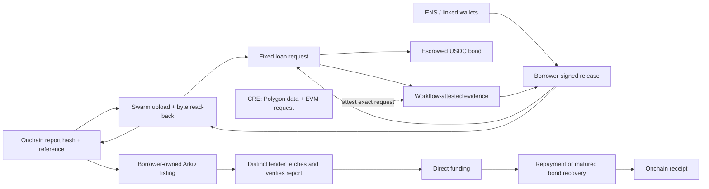

<Warning>
Preserved source document. Status, interface examples and proposals are historical where noted; consult the current guides and source-derived references before integration. This page is generated, not a new execution or audit claim.
</Warning>

[Original Markdown source](https://github.com/debojyoti10CC/floorprt/blob/main/docs/ETHGLOBAL_SUBMISSION.md) · [Current documentation scope](/maintenance/source-audit)

**Status date:** 6 November 2026. This brief describes the current AQRA trader-credit app, not the earlier Floor Protocol terminal.

## One-line pitch

**AQRA is a prediction-market performance-metrics-based lending protocol: it scores dated trader history to gate a bonded loan request, then lets a lender verify the attested metrics and choose whether to fund.** The score is not a repayment model or collateral.

## Submission description

Prediction-market traders can expose public, settled trading history, but that history is not a credit record. AQRA uses activity, repeat profitability, realized P&amp;L efficiency and drawdown as explicit underwriting metrics. A qualifying borrower posts a USDC bond; the lender reads the dated inputs, checks that their digest matches the attested report, and chooses whether to accept the uncovered loss. The benchmark tests future trader P&amp;L—not repayment—and pooled lending stays rejected until real loan outcomes and committed capital exist.

## The mechanism

### Four application destinations

1. **Data:** sampled market coverage, walk-forward policy comparison, address-level underwriting metrics and export.
2. **Risk engine:** assumption-driven credit loss and discrete portfolio stress. It rejects pool underwriting because the model has no loan labels or committed reserve.
3. **Borrow:** wallet/ENS discovery, as-of evidence, scoped linked-wallet consent, fixed terms and bond escrow.
4. **Lend:** Arkiv discovery, exact Swarm report retrieval and hash/recomputation checks, loss acknowledgement, direct funding, borrower repayment or matured default, with receipts.

## What the data says

The checked-in sample spans November 2025 through October 2026. It schedules 768 BTC/ETH 15-minute sessions; 764 markets were captured as resolved. The artifact includes 3,906 wallet histories, 3,647,433 fill rows, 1,025,654 daily P&amp;L observations, 15 of 15 verified month-boundary blocks, 6,155 candidate wallet-month rows and 11 completed forward rounds.

| Selection rule | Positive following-month P&amp;L | Sample size |
| --- | ---: | ---: |
| Consistency screen | 154 / 220 · 70.0% | 220 wallet-months |
| Largest monthly P&amp;L | 162 / 220 · 73.6% | 220 wallet-months |
| 10× to below 100× settled buy | 55 / 160 · 34.4% | 160 wallet-months |
| At least 100× settled buy | 2 / 4 · 50.0% | 4 wallet-months |
| Seeded sample baseline | 61 / 220 · 27.7% | 220 wallet-months |

The consistency screen is 42.3 percentage points above the seeded baseline and 3.6 points below the simple largest-monthly-P&amp;L comparator. Wallet-month observations can repeat addresses. Discovery, survivorship, market regime and source-coverage bias remain. This is evidence to test a screening hypothesis; it is **not** repayment evidence, credit lift, borrower PD, lender yield, return on equity or a causal result.

## Loan economics and the honest risk statement

Current demo terms are $100 principal, $102 total due and $25 posted bond. If the borrower defaults and the entire bond is recovered, up to $75 of principal remains unpaid. A token, contract or operational failure can make recovery lower. The lender knowingly takes that risk; there is no pool, guarantee, seized trading position or right to future trading profits.

The risk engine lets a user vary assumed PD, default dependence, recovery haircut, tail confidence, costs and scenario capital. These are not measured loan statistics. The pooled-credit gate remains `REJECT` until AQRA has matured repayment/default labels, calibrated and out-of-time-validated PD, and genuinely committed loss capital.

## Demo sequence

The repository does not currently have a Bee URL, funded postage batch or live Rabdi writer configured. The complete external storage flow is therefore implemented but not yet an honest live demo. Do not imply a testnet upload or loan funding has happened until it is executed with those resources.

After configuration, use this sequence:

1. Show the benchmark sample counts and observed cohort rates. Point out that the simple prior-month P&amp;L comparator exceeds the consistency screen by 3.6 percentage points and neither measures repayment.
2. Change one risk assumption and show the loss distribution, VaR/ES and unchanged pooled-credit `REJECT` gate.
3. Create or open a borrower-owned request and show its onchain attestation and fixed terms.
4. Preview the complete report disclosure, inspect linked wallets/metrics/cutoff/SHA-256, and sign the time-limited public-release message.
5. Show Bee upload, read-back verification, borrower commitment transaction, and wallet-owned Arkiv publication receipt.
6. Switch to a separate lender session; discover the listing on Arkiv, fetch the exact Swarm reference, and show digest/hash/contract checks pass. Then acknowledge the $75 shortfall and fund with test USDC.
7. Repay or mature the loan and show the receipt. Demonstrate that repayment/default still work if Arkiv/Swarm is unavailable.
8. For the CRE bounty, run and show successful official `cre workflow simulate` output with Polygon API reads and the EVM request. Do not label this a public DON write.

Without the external service configuration and a second wallet, limit the demo to the local request/attestation path and explicitly show funding disabled. The local impersonation utility is not borrower consent.

## Sponsor readiness

| Sponsor path | Assessment on 6 November |
| --- | --- |
| **Chainlink CRE** | Closest fit. The workflow source is present and connects an external Polygon/Polymarket API with the EVM request. No successful official CLI simulation or live workflow is yet recorded. Complete that exact demo gate. |
| **Arkiv + Swarm** | New code now uploads and reads back the consented assessment via Bee, commits SHA-256/reference in the lending contract, writes an expiring Arkiv v2 listing and fetches the exact report before UI funding. No Bee configuration, postage batch, Rabdi write/read receipt or second-wallet proof is recorded yet. The existing-project prize requires Continuity registration and event-new evidence; eligibility remains unconfirmed. |
| **Arc** | No Arc integration exists here. Every Arc prize requires an Arc Studio-originated project, a shareable Studio project URL and showing Studio in the demo, plus a working app/backend, architecture diagram and presentation. Arc Continuity additionally requires Continuity registration. Do not claim Arc eligibility yet. |

Official requirements: [ETHGlobal Mumbai prizes](https://ethglobal.com/events/mumbai/prizes), [Arc prizes](https://ethglobal.com/events/mumbai/prizes/arc), [Chainlink CRE](https://docs.chain.link/cre), [Arkiv Rabdi](https://docs.arkiv.network/networks/rabdi/).

## Judge proof bundle

- Public repository with install/run steps, current four-screen scope and explicit limitations.
- Fixed-schedule benchmark artifact, source capture manifest and exact cohort table.
- Contract addresses, code identity, chain ID, transaction hashes, event indices and before/after test-USDC balances for the recorded demo.
- A CRE simulation transcript and workflow config with credentials removed; separately record any public DON transaction if one later exists.
- If entering Arkiv: writer address, entity schema/expiry/ownership, reproducible query, transaction/entity key, Swarm reference/hash pair, a lender-visible read receipt, and the required `/arkiv/` criterion files. The code path alone is not the external proof.
- If entering Arc: shareable Studio project URL, functional Arc flow, architecture diagram and video showing Studio.
- A short video, under the applicable event limit, showing the whole core flow and one fail-closed condition.

## Submission guardrails

- Say **prediction-market performance-metrics-based lending**, **policy-gated borrower request**, **bond-backed direct loan**, and **lender-accepted shortfall**.
- Do not say that trader history predicts repayment, that the 70% outcome is credit accuracy, or that the loan is safe because of the bond.
- Do not describe the local impersonation demo as real borrower consent or real funds.
- Do not describe a CRE simulation as a live oracle write, an Arkiv code path as a confirmed transaction, or the current repo as an Arc project.
- Treat registration in ETHGlobal's Continuity program as unknown until the team verifies it.
