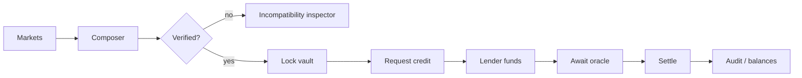

<Warning>
Preserved source document. Status, interface examples and proposals are historical where noted; consult the current guides and source-derived references before integration. This page is generated, not a new execution or audit claim.
</Warning>

[Original Markdown source](https://github.com/debojyoti10CC/floorprt/blob/main/docs/FRONTEND_UX.md) · [Current documentation scope](/maintenance/source-audit)

# Frontend Product Experience and Visual Specification

**Design direction:** institutional quant terminal × research lab × visual portfolio composer. This must feel like a complete product, not a template dashboard. Dark mode primary, restrained chart colors, meaningful state transitions. Never imply a demo feed is live financial-market execution.

## 1. Design philosophy

- Frontend demonstrates **cause → mathematical verification → real onchain effect**.
- Financial instruments always show **settlement floor**, **indicative market price**, and **upfront acquisition cost** as separate measures; never label floor as instant redemption or guaranteed profit.
- Numeric precision and provenance visible on hover or detail; USDC amounts in 6 decimals, token quantities whole integers.
- 80% of visual impact from interaction and information hierarchy—not motion for its own sake.
- Use clear failures and contradictions: incompatible observations should visibly *fail verification* with exact rule explanation.

## 2. Visual design tokens (proposed)

```css
:root {
  --bg: #080D15;
  --surface: #101925;
  --surface-raised: #162132;
  --border: #263247;
  --text: #EAF0FA;
  --muted: #9DACBF;
  --accent: #6BA7FF;
  --positive: #38C79A;
  --negative: #F27878;
  --warning: #E8BE72;
  --radius-card: 14px;
}
```

Fonts: Inter/Geist for UI, IBM Plex Mono/JetBrains Mono for prices and addresses. Use 8px spacing rhythm. One prominent gradient reserved for certified proof visualization. Color must not be the only status indicator. 1440px desktop primary with sidebar (232px), context header (64px), content grid, fixed right inspector panel on composer.

## 3. Routes and required screens

### `/terminal` — Home / overview

Large top metrics: onchain locked claims, total verified settlement floor, active USDC loans, loans awaiting finalization, indexed block age. Left: selected market table; center: portfolio opportunity graph; right: latest verified vault and settlement events. `Active contracts` and `TESTNET` labels. Quick action `Compose a floor`.

**Done when**: every onchain figure has chain read or indexed log; no invented TVL. Empty state offers one-click seeded test scenario.

### `/markets` — Discovery

Table/card hybrid with asset, two threshold conditions, oracle observation ID, resolution timestamp, liquidity (only when actually available), and eligibility status. Include read-only external markets in separated tab called `Research feed`; never mix into approved collateral list. Search and filter by same observation, strike range, maturity, verification. Clicking two eligible thresholds offers `Add pair to composer`.

**Done when**: wrong asset/time/oracle pairs visibly fail despite similar titles.

### `/compose` — Visual Portfolio Studio (hero screen)

Three panes:

1. **Outcome Graph:** React Flow nodes for shared observation, lower-threshold market, upper-threshold market, YES/NO tokens and validity edges. Unshared edges dashed and red with reason.
2. **Composition canvas:** chips for positions with units and current wallet balances; add/remove via click or drag; support keyboard alternative.
3. **Payoff studio:** ECharts step curve with live slider `ETH/USD at settlement`, CANCELLED toggle, horizontal `Certified floor` line, cards `min payout`, `max payout`, `minimum borrower surplus after debt`, and contract rules.

Transitions: selecting an eligible pair animates links between nodes; the proof line appears **only after onchain verification**. A speculative analytics score (P1) never changes verified floor.

**Done when**: graph, exact scenario row and verifier contract agree for 4,500 / 5,000 / 5,500 / 6,000 / 6,500 / CANCELLED.

### `/proof/:positionDraftId` — Proof Inspector

Top: proof status `[VERIFIED]` or `[INELIGIBLE]`, version, observation registry, onchain factory, codehash/address, `1.000000 USDC` terminal floor. Center: full finite state partition table with numeric inequalities, token payouts, minimum. Bottom: Assumptions &amp; Risks (oracle may be late, no secondary liquidity, collateral backing risk, cost/profit separate). `Lock in vault` action only when viewer holds both ERC-1155 tokens and chain view verifies eligibility.

**Done when**: every label can be traced to chain metadata; proof digest cannot be forged client-side.

### `/credit` — Credit Desk

Two tabs:

- **Borrow:** your locked vault positions, certified floor, buffer, allowed repayment cap, requested principal, maximum lender fee/due, request expiry and eligibility. Show clear loan math. Provide separate 'not instant withdrawal' risk statement.
- **Lend:** open borrower requests, immutable collateral inventory, minimum payout scenarios, term assumptions and a funding form. Wallet B funds with test USDC; surface allowance/transaction progress.

On funding, a high-signal activity feed shows three distinct real effects: collateral is encumbered; lender USDC transferred; borrower USDC increased.

**Done when**: distinct wallets can complete onchain funding and screenshots match receipts.

### `/portfolio` — Positions and liabilities

Grouped panels for free ERC-1155 outcomes, locked proof positions, borrowed USDC, lender claim receivables, resolved loans. Show `owner`, `beneficiary`, `market pair`, `status`, `floor`, `debt due`, `release after settlement` and tx links. Do not show notional 'wallet worth' as if terminal values were market prices.

### `/settlements` and `/settlements/:loanId` — Audit and cashflow visualization

View timeline: `Observation created → markets minted → pair certified → collateral locked → loan funded → oracle final → claims redeemed → lender repaid → borrower surplus`. Sankey/animated waterfall ties amounts to exact USDC transfer events. Resolution table identifies whether `PRICE` or `CANCELLED` terminal state occurred. Each item has explorer link and event name.

**The main pitch screenshot:** side-by-side verification proof and cashflow waterfall with real transaction IDs.

### `/ops` — Demo/admin only

Display testnet configuration, fake oracle resolver controls behind explicit admin wallet check, time-warp simulation on local Anvil, health, contract addresses and read-only test cases. On public testnet disable controls from unauthorized users; not a general backend signing endpoint.

## 4. Critical user journey



## 5. Reusable components

`ChainStateBanner`, `WalletConnect`, `ObservationBadge`, `MarketSelector`, `OutcomeNode`, `CompatibilityEdge`, `TokenBalance`, `PositionChip`, `ScenarioSlider`, `StepPayoffChart`, `FloorLine`, `ProofRuleTable`, `CertifyBadge`, `ProofAssumptions`, `TxComposer`, `AllowanceStepper`, `VaultInventory`, `CreditRequestPanel`, `LoanOfferCard`, `LoanHealth`, `ResolutionTimeline`, `SettlementSankey`, `ExplorerLink`, `StaleFeedWarning`, `DemoSeedPanel`.

## 6. Interaction specifications

- **Hover** a payoff segment → show exact inequalities and which token is paying. At `p=L` and `p=U`, open/closed boundaries must be obvious.
- **Change quantities** → show `min(qL,qU)` floor and different surplus before any transaction; no float rounding.
- **Swap observation ID** → graph's connecting edge turns invalid; explain `same price source is not enough; must be same immutable observation`.
- **Lock** → a visible stepper `Approve ERC-1155 operator → Sign lock → Confirm blocks → Verifier accepted → Vault created`.
- **Fund** → show lender and borrower account identities and both deltas; handle reverts and expiry.
- **Resolve** → price slider is simulation only until resolver's actual onchain event has confirmed; set screenshot mode separate from contract state.
- **Cancel** → reflect both markets paying 50/50; do not display a 0.5 floor for matched pair when it is actually 1.0.
- **Settle** → waterfall amount derived from contract cashflow events; no arbitrary chart hardcoded in production mode.

## 7. UI copy and ethics

Preferred: `Certified minimum settlement payout (conditional)`, `Fixed repayment obligation`, `Eligible collateral`, `Onchain observation`, `Testnet funds`. Forbidden in MVP: `Risk-free`, `Guaranteed profit`, `Insurance`, `No-loss lending`, `Instantly redeemable $1`, `Real Polymarket collateral` unless actually integrated.

## 8. Responsive design and accessibility

Desktop 3 panes collapse to tabbed graph/payoff/proof on mobile. Use keyboard to add positions, update unit counts and run verification; focus ring on graph nodes; alternative payoff table for screen readers; tabular numerals and explicit currency units; reduced-motion mode and status live regions for tx updates.

## 9. Screenshot checklist for judges

1. Default Terminal with seeded onchain metrics.
2. Composer graph with connected observation edges and visible threshold axis.
3. The Proof Inspector showing 1 USDC floor plus state table.
4. Borrower request and lender funding approval with addresses.
5. Settlement waterfall showing $2 gross, $0.78 to lender, $1.22 borrower; explorer transaction.
6. Rejection scenario for conflicting observation IDs to prove verifier isn't decorative.
