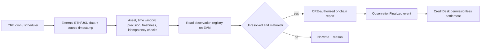

<Warning>
Preserved source document. Status, interface examples and proposals are historical where noted; consult the current guides and source-derived references before integration. This page is generated, not a new execution or audit claim.
</Warning>

[Original Markdown source](https://github.com/debojyoti10CC/floorprt/blob/main/docs/INTEGRATIONS_AND_PRIZES.md) · [Current documentation scope](/maintenance/source-audit)

# Integration Strategy, Sponsor Qualification and Research Boundaries

**Checked:** 6 November 2026. Recheck live official rule pages before submission; prize rules and supported networks can change. This is *eligibility planning*, not a guarantee of prizes.

## 0. Current implementation evidence

- **AQRA core:** local Anvil lifecycle is implemented and tested; public Sepolia support has a separate deployment script and pinned-feed adapter. See `README.md` and `docs/RELEASE_EVIDENCE.md` for the exact evidence boundary.
- **Arkiv:** the composer now has an SDK-backed Rabdi query/write/delete path for public 30-day portfolio recipes. It rechecks in AQRA before lock and only loads recipes from the configured AQRA chain, registry and vault. **No public Rabdi write/read receipt or writer wallet is recorded yet**, so this is an implementation path, not a qualified track claim. Arkiv criterion notes are in `arkiv/`.
- **Chainlink CRE:** no CRE workflow, CLI simulation or DON execution is present. The local test resolver and the Sepolia historical Chainlink feed resolver are not CRE.
- **Arc:** no Arc contract deployment or Arc Studio project URL is present. Current Mumbai Arc prizes require Arc Studio as the starting point; a plain deployment from this repository does not qualify.

Research about prior winners and recommendations for the seven current screens is in `docs/HACKATHON_WINNER_RESEARCH.md`. No current Mumbai winner is described as a winner in that research; it references completed prior events.

## 1. Base chain strategy

**Primary engineering track:** Anvil locally, then **one** EVM public testnet with fully funded mock collateral; ABI addresses and chain ID pinned. Choose Arc only if the team really begins required work in Arc Studio and can satisfy its submission constraints. Avoid an extra Polygon, Ethereum, Base and Arc deployment that splits engineering effort and breaks actual custody.

The phrase 'Ethereum-native' means EVM-compatible contracts and Ethereum wallet tooling; it does **not** imply native deployment on Ethereum mainnet. Show the actual chain in the UI.

## 2. Chainlink CRE — strongest direct sponsor synergy

Official pages: [CRE docs](https://docs.chain.link/cre/overview), [ETHGlobal Mumbai prizes](https://ethglobal.com/events/mumbai/prizes).

**Recommended meaningful workflow:** after observation timestamp, CRE reads a named external ETH/USD feed and its timestamp, validates canonical decimal precision and reporting window, reads observation status on the target chain, produces a bounded transaction through a configured authenticated receiver, and records the execution and verification trail. It must block stale, future-dated or mismatched source data. It must not be used as a blind arbitrary-price signer. This workflow is not yet implemented in this repository.

**Submission requirement:** for the Mumbai CRE bounty, a meaningful workflow integrating blockchain and an external API/data source needs a successful CRE CLI simulation **or** live deployment. Save `workflows/`, configs, output logs, screenshots and README command. A browser mock isn't a CRE integration. The bounty listed $1,500 at inspection; final eligibility is sponsor-determined.

**Trust statement:** CLI simulation shows orchestration working, not that the production DON has finalized the specific loan; the demo must distinguish simulated workflow from real onchain oracle write.

## 3. Arc — relevant but nontrivial qualifier

Official [Arc Mumbai prize listing](https://ethglobal.com/events/mumbai/prizes). Arc lists prizes for DeFi/onchain finance and advanced programmable stablecoin logic. **Every Arc prize requires Arc Studio as the starting point**, a shareable Studio project URL, and showing Studio in the demonstration. Merely copying the project from Codex and deploying to Arc does not meet this.

**Studio-first plan if selecting Arc:**

1. Start the project in Arc Studio using the outcome collateral/lending brief.
2. Ensure Studio authors/tests actual app-and-contract implementation steps. Preserve the project link and screens.
3. Bring the generated code into a fresh git repository for Codex-driven hardening only if allowed and documented.
4. Deploy all contracts on Arc testnet using the supported asset and gas model. Do not confuse freely-mintable `MockUSDC` with canonical USDC.
5. Explain how Studio contributed in the video and provide diagram + running end-to-end demo.

**Recommendation:** Prioritize shipping the truthful protocol and CRE workflow; Arc can become the primary network if team bandwidth and Studio constraints are met early. Don't optimize for two sponsor tracks by implementing two disconnected apps.

## 4. Uniswap — optional, not required for P0

The published Mumbai Uniswap prize requires actually building with Uniswap APIs or protocol stack and a public repository plus `FEEDBACK.md` and feedback form. A static Uniswap logo or an unrelated swap button does not qualify. The credible integration is **P1 tradeable vault/structured-note ERC-20 wrappers or a fee-aware liquidity market for claims**, with actual onchain swap paths and test trades. Do **not** wrap collateral certificates that are already lien-encumbered, creating double collateral. If P0 is incomplete, cut this entirely.

## 5. Polymarket — safe read-only discovery first

The project's original market-risk inspiration uses the live Polymarket Gamma API. Use it to show research and candidates, with source links, update timestamp, terms and venue restrictions. **No Polymarket trades/positions will be in the P0 loan vault.** Real Polymarket outcome tokens are CTF ERC-1155 claims issued on Polygon, resolved under market-specific conditions. They cannot be treated as identical to our own shared-observation testnet tokens or represented as directly transferable into Arc/Sepolia without an actual bridge/custody adapter.

A future native-Polygon adapter would verify CTF token IDs, collateral, question/condition IDs, payout vectors, oracle identity, invalid/void rules, observation time and chain-specific custody. This requires substantial extra security review and a truthful UI distinction between *candidate*, *supported* and *certified*.

## 6. Licensing and prior-work disclosure

ETHGlobal [event rules](https://ethglobal.com/rules): the Classic “From Scratch” category requires project-specific coding to begin at event kick-off. Pre-existing source, designs, and assets are not allowed as new work for Classic; Continuity has separate requirements, and prior work must be disclosed. A blueprint prepared beforehand is not proof that a later implementation complied; follow organizers' specific instructions. This package contains original specification text, not copied Senthos/Cumulant code.

## 7. Demo proof of integration checklist

| Integration | Evidence required | P0 priority |
|---|---|---|
| Own outcome markets | verified contract addresses + transaction for complete-set mint | Mandatory |
| Vault/lending | funded loan + onchain settlement tx and events | Mandatory |
| Arkiv Rabdi | SDK-backed public recipe query/write/delete code; actual entity key, wallet-signed create transaction and second read-back in README | Code path exists; public receipt pending |
| Chainlink CRE | workflow code + CRE CLI simulation output + genuine external API → EVM connection | High sponsor priority |
| Arc Studio | shareable Studio URL and video; show full stack in Studio | Only if pursuing Arc |
| Dynamic embedded wallet | real login + wallet-signed transactions | Optional, only if integrated |
| Uniswap | actual executed swap and code references + feedback form | Optional P1 |
| Polymarket | data fetch proof + explicit research-only labeling | Optional UX, not collateral eligibility |

## 8. Legal/product positioning

Not financial advice, no credit underwriting or investment guarantee. Prediction-market participation and debt issuance may be regulated in relevant jurisdictions. A testnet demonstration is not licensed product distribution. Provide jurisdiction restrictions and risk statements before public live launch.
